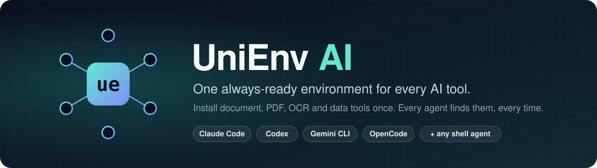
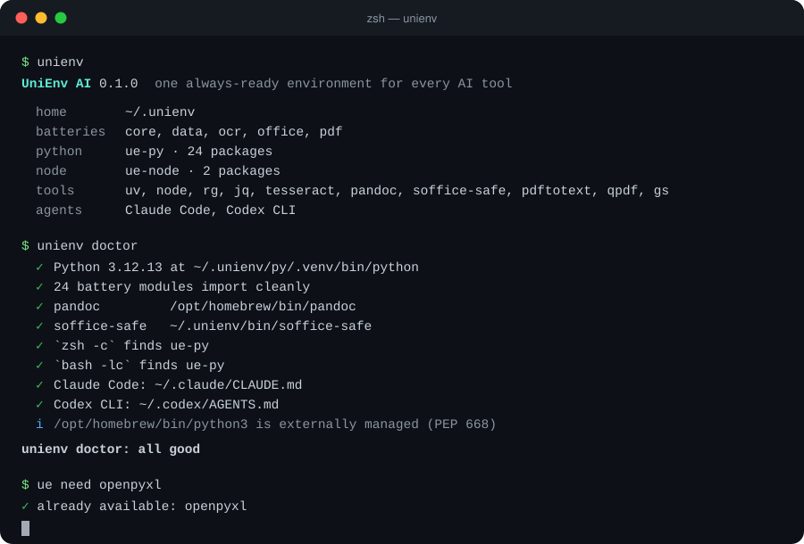
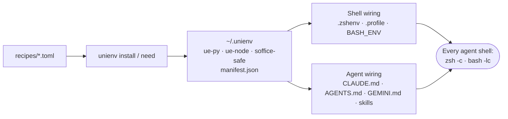

<p align="center">
  
</p>

<p align="center">
  <a href="https://github.com/rupeshbharambe24/unienv-ai/actions/workflows/ci.yml"></a>
  <a href="https://github.com/rupeshbharambe24/unienv-ai/releases"></a>
  
  
  <a href="#license"></a>
  <a href="CONTRIBUTING.md"></a>
</p>

<p align="center">
  <b>Works with</b> Claude Code · Codex CLI · Gemini CLI · OpenCode · <b>Claude Desktop (MCP)</b> · any agent that runs shell commands
</p>

<p align="center">
  <a href="#-quick-start">Quick start</a> ·
  <a href="#-how-it-works">How it works</a> ·
  <a href="#-batteries">Batteries</a> ·
  <a href="#%EF%B8%8F-commands">Commands</a> ·
  <a href="docs/ai-tools.md">AI tools</a> ·
  <a href="ROADMAP.md">Roadmap</a> ·
  <a href="CONTRIBUTING.md">Contribute</a>
</p>

---

You ask your AI agent to *"fix the table in this Word file"* or *"summarise this spreadsheet"*. Then you watch it:

```text
✗ ModuleNotFoundError: No module named 'docx'
✗ error: externally-managed-environment        (Homebrew Python refuses pip)
  python3 -m venv /tmp/venv-8f2a && pip install python-docx openpyxl …   (again)
✗ soffice: command not found
```

**…and next session it does it all again.** Every AI tool, every task, from zero.

**UniEnv AI** installs those tools **once**, in **one place**, and tells **every AI tool on your machine** where they are.

```text
✓ ue-py -c "import docx, openpyxl"      # already there, for every agent, every session
✓ soffice-safe --convert-to pdf report.docx
✓ ue need seaborn                        # missing? installed permanently, for everyone, in seconds
```

<p align="center">
  
</p>

## ✨ Why UniEnv

<table>
<tr>
<td width="50%" valign="top">

**🔋 Batteries included**<br>
Word, Excel, PowerPoint, PDF, OCR and data tools, ready on day one: python-docx, openpyxl, python-pptx, pandas, pypdf, markitdown, pandoc, LibreOffice, Poppler, tesseract, duckdb and more.

</td>
<td width="50%" valign="top">

**🤝 Every AI tool, one environment**<br>
Claude Code, Codex, Gemini CLI and OpenCode get a managed instruction block and skill; **Claude Desktop chat** and other MCP apps get the same tools through the built-in **MCP server**.

</td>
</tr>
<tr>
<td valign="top">

**🐚 Works in the shells agents really use**<br>
Agents run every command in a fresh `zsh -c` / `bash -lc`, which skips your `.zshrc`. UniEnv wires every shell mode, and `doctor` proves it.

</td>
<td valign="top">

**♻️ Grows instead of resetting**<br>
`unienv need <pkg>` installs permanently for every tool, takes about 2 s with a warm cache, and rolls back automatically if anything breaks.

</td>
</tr>
<tr>
<td valign="top">

**🩺 Self-diagnosing**<br>
`unienv doctor --json` checks tools, imports, shell wiring, agent files and secrets hygiene, so agents can diagnose instead of blindly reinstalling.

</td>
<td valign="top">

**🧹 Never in your way**<br>
No `python`/`node` shadowing (only namespaced `ue-*` commands), project envs come first, no Docker, no telemetry, and `unienv uninstall` removes every line it wrote.

</td>
</tr>
</table>

## 🚀 Quick start

```sh
curl -fsSL https://raw.githubusercontent.com/rupeshbharambe24/unienv-ai/main/install.sh | bash
```

Or from a clone:

```sh
git clone https://github.com/rupeshbharambe24/unienv-ai.git && cd unienv-ai && ./install.sh
```

The first install shows an interactive picker for the batteries you want. Then **restart your AI tools** (or open a new terminal) and check:

```sh
unienv doctor
```

> **Requirements:** macOS with [Homebrew](https://brew.sh), or Linux (Python/Node batteries work everywhere; apt packages are listed for you to install). [uv](https://docs.astral.sh/uv/) is installed automatically if missing.

<details>
<summary><b>Install options</b></summary>

```sh
./install.sh --batteries office,pdf      # choose batteries non-interactively
./install.sh --exclude libreoffice       # skip a tool and remember it (`ue need --cask libreoffice` adds it back)
./install.sh --no-system                 # skip Homebrew/apt entirely
./install.sh --dev                       # contributors: run straight from this checkout
unienv install --add media,fonts         # add opt-in batteries later
unienv update                            # get the latest version
```
</details>

### Try it

Open your AI tool **outside any project** and ask:

> *"Create a Word document summarising the PDF in my Downloads folder, then convert it to PDF."*

It should use `ue-py`, `pdftotext` and `soffice-safe` directly, with no virtualenv and no installs.

## 🔋 Batteries

| Battery | Default | What agents get |
|---|:---:|---|
| `core` | always | uv, Node.js, ripgrep, jq |
| `office` | ✅ | python-docx, openpyxl, xlsxwriter, python-pptx, markitdown, docx-js, pptxgenjs, pandoc, LibreOffice (`soffice-safe`) |
| `pdf` | ✅ | pypdf, pdfplumber, pypdfium2, reportlab, pdf2image, Poppler (`pdftotext`, `pdftoppm`), qpdf, Ghostscript |
| `data` | ✅ | pandas, numpy, pyarrow, duckdb, matplotlib, requests, httpx, beautifulsoup4, pyyaml |
| `ocr` | ✅ | tesseract + pytesseract (English; `ue need --bin tesseract-lang` for more) |
| `media` | opt-in | ffmpeg, ImageMagick |
| `fonts` | opt-in | Carlito, Caladea, Liberation, Noto CJK (so LibreOffice renders match Word) |

Each battery is a small, declarative [TOML recipe](recipes/office.toml). **Adding one is the easiest way to contribute**: LaTeX, browsers, diagrams, GIS, audio… see [CONTRIBUTING.md](CONTRIBUTING.md#writing-a-recipe).

## 🧭 How it works



1. **Install once.** Homebrew installs the system tools, uv builds a pinned **Python 3.12** env, and npm builds the Node packages, all under `~/.unienv`.
2. **Wire every shell.** One guarded line in `~/.zshenv` / `~/.profile` / `~/.bashrc` sources `~/.unienv/env.sh`, so the bare shells agents open see the tools too.
3. **Tell every agent.** A managed block in each tool's global instructions, plus a `unienv` skill, lists what's installed and the rules: *use the project's env inside projects, `ue-py` outside, `unienv need` for anything missing.*
4. **Verify.** `unienv doctor` launches shells from an empty environment, imports every module and checks every agent file.

Details: [How it works](docs/how-it-works.md) · [AI tool integrations](docs/ai-tools.md) · [Troubleshooting](docs/troubleshooting.md)

## ⌨️ Commands

| Command | What it does |
|---|---|
| `unienv` | Status dashboard: batteries, packages, tools, configured agents |
| `unienv install` | Install batteries, wire shells and AI tools, run `doctor` |
| `unienv need <pkg>` | Add a package permanently: Python (default), `--node`, `--bin` (Homebrew formula), `--cask` (app) |
| `unienv doctor [--json] [--fix]` | Verify everything; `--json` for agents and CI |
| `unienv list [--json]` | All batteries, packages and tool paths |
| `unienv sync` | Regenerate shims, `env.sh`, `manifest.json` and agent blocks |
| `unienv update` | Download the latest UniEnv and re-install |
| `unienv wire [--gui]` | Rewrite shell blocks; `--gui` (experimental, macOS) sets the PATH desktop apps see |
| `unienv mcp install [--client …]` | Connect Claude Desktop / Cursor / other MCP apps ([guide](docs/mcp.md)) |
| `unienv uninstall [--purge]` | Remove everything UniEnv wrote; `--purge` also deletes `~/.unienv` |

`ue` is a short alias for `unienv`.

## 🤖 Supported AI tools

| Tool | Status |
|---|---|
| Claude Code | ✅ instructions + skill + shell |
| Codex CLI | ✅ instructions + skill + shell |
| Gemini CLI | ✅ instructions + shell |
| OpenCode | ✅ instructions + shell |
| Cursor, Windsurf, Cline, Roo, Copilot, Aider | ◐ shell works; paste `~/.unienv/AGENTS.md` into user rules. [Adapters wanted](https://github.com/rupeshbharambe24/unienv-ai/labels/adapter) |
| **Claude Desktop chat** | ✅ via the UniEnv MCP server: `unienv mcp install` or the one-click `.mcpb` extension ([guide](docs/mcp.md)) |
| LM Studio & other MCP apps | ✅ via MCP: `unienv mcp config` prints the snippet |
| Claude.ai / ChatGPT on the web, Cowork | ❌ they run in the cloud or a VM and can't reach your computer |

## ❓ FAQ

<details>
<summary><b>Will this mess with my projects' virtualenvs?</b></summary>

No. UniEnv never puts `python`, `python3` or `node` on PATH; it only adds namespaced commands (`ue-py`, `ue-node`). Agents are explicitly told to use a project's own environment (`uv run`, `.venv/bin/python`, npm) inside projects. UniEnv is for everything outside them.
</details>

<details>
<summary><b>Why not just use Docker or a devcontainer?</b></summary>

Your agents run on your machine, with your files. Containers are great for isolation but give up the host, and desktop apps can't easily use them. UniEnv is native-first; container export from the same recipes is on the [roadmap](ROADMAP.md).
</details>

<details>
<summary><b>I use Microsoft Office. Do I need LibreOffice?</b></summary>

LibreOffice is for the *agent*, not for you. It lets agents convert files to PDF or images to check their own layout, recalculate formulas written by Python, and convert old `.doc`/`.xls` files. You keep using Word and Excel. Skip it with `--exclude libreoffice` if you like.
</details>

<details>
<summary><b>What exactly does it change on my system?</b></summary>

Everything lives in `~/.unienv`, except one guarded line in your shell startup files and a marked block in each detected AI tool's instruction file. Every one of those is listed in [How it works](docs/how-it-works.md#what-unienv-writes-outside-unienv) and removed by `unienv uninstall`.
</details>

<details>
<summary><b>Is it safe to let agents run <code>unienv need</code>?</b></summary>

It installs from the same public registries an agent would use anyway (PyPI, npm, Homebrew), but **once**, logged to `~/.unienv/log/unienv.log`, and flagged when the package isn't in a curated recipe. Your AI tool's permission prompt still gates the command. See [SECURITY.md](SECURITY.md).
</details>

<details>
<summary><b>Windows?</b></summary>

Not yet: Windows (winget/Scoop) and WSL are planned for 1.0. Help is very welcome.
</details>

## 🧪 Measured

**Our benchmark** ([details](bench/README.md)): Claude Code, *"put this text into a Word document"*, same machine, before vs after UniEnv:

| | Without UniEnv | With UniEnv |
|---|---|---|
| Typical time | ~22 s | **~9.6 s (2.3× faster)** |
| Agent turns | 4–5 | **2** |
| Packages installed during the task | every run (temp venv / npm) | **none** |
| Correct document | 3/3 | 3/3 |

*n = 3 per group on one Mac. Small, but reproducible with [`bench/word-task.sh`](bench/word-task.sh). PRs with your own results are welcome.*

This project started as [research into why AI agents keep failing at environments](docs/research.md):

- In **SetupBench**, even the best model wasted **69%** of its environment-setup steps and used **1.1M tokens per task**.
- **JetBrains** found that just telling agents where the right Python is lifted task success from **68% to 98%**.
- Across Claude Code, Codex, Gemini CLI, Cursor and Cline, the top-reported issues are the same: lost venvs, missing binaries, PATH differences between shells and GUI apps, and sandboxes blocking installs.

UniEnv's bet: **agents aren't bad at environments; they're blind to them.** Make the environment persistent, shared and *described*, and the reinstall loop disappears.

## 🤝 Contributing

UniEnv is built to be extended by the community. The best first contributions:

- 🔋 **A new battery**: one TOML file, no code ([guide](CONTRIBUTING.md#writing-a-recipe))
- 🤖 **An adapter** for another AI tool ([guide](CONTRIBUTING.md#writing-an-agent-adapter))
- 🐧 **Linux/Windows backends**
- 🐛 **Bug reports** with `unienv doctor --json`

Look for [`good first issue`](https://github.com/rupeshbharambe24/unienv-ai/labels/good%20first%20issue), read [CONTRIBUTING.md](CONTRIBUTING.md), and say hi in [Discussions](https://github.com/rupeshbharambe24/unienv-ai/discussions). If UniEnv saves you time, a ⭐ helps others find it.

## License

Dual-licensed under [MIT](LICENSE-MIT) or [Apache-2.0](LICENSE-APACHE), at your option. Tools installed by recipes keep their own licenses (see each recipe's `license_note`).
