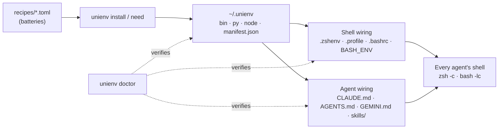

# How UniEnv works

UniEnv is thin glue. Homebrew, uv and npm do the installing; UniEnv decides **what** to install, puts it in **one stable place**, and makes sure **every shell and every AI tool knows about it**.

## The prefix: `~/.unienv`

| Path | What it is |
|---|---|
| `bin/` | `ue-py`, `ue-node`, `soffice-safe`, `unienv`, `ue`. Namespaced, so they never shadow `python`, `python3` or `node`. |
| `py/` | A uv project pinned to Python 3.12: `pyproject.toml`, `uv.lock`, `.venv/`. Resolved for this machine's platform only. |
| `node/` | An npm prefix (`package.json`, `node_modules/`). `ue-node` puts it on `NODE_PATH`. |
| `env.sh` | The one file every shell sources. It adds `bin/` (and Homebrew) to PATH, sets `BASH_ENV`, and fixes macOS `TMPDIR` quirks. |
| `manifest.json` | What is installed, with versions and absolute paths. Agents and desktop-app configs can read it. |
| `AGENTS.md` | The instruction block, for tools without a known global file (paste it into Cursor's User Rules, for example). |
| `state.json` | Your batteries, extras added with `need`, and options such as `exclude`. |
| `share/` | The CLI, recipes and templates (a symlink to your checkout in `--dev` mode). |
| `backups/` | Snapshots taken before every `need`, used for rollback. |
| `log/unienv.log` | One JSON line per install, sync and `need`. |

## Why each shell file?

AI agents run each command in a **fresh, non-interactive** shell, which skips the files most people configure:

| Shell mode | Reads | Wired by UniEnv |
|---|---|---|
| `zsh -c` (Claude Code, many agents on macOS) | `~/.zshenv` only | ✅ `~/.zshenv` |
| `zsh -lc` (login) | `~/.zshenv`, `~/.zprofile` | ✅ |
| `bash -lc` (Codex and others) | `~/.bash_profile` **or** `~/.bash_login` **or** `~/.profile` (first found) | ✅ all three when present |
| `bash -c` (non-login) | only `$BASH_ENV` | ✅ `BASH_ENV` exported from `env.sh` |
| Interactive bash | `~/.bashrc` | ✅ if it exists |
| GUI apps (Dock/Finder) | nothing: launchd's minimal PATH | ◐ use absolute paths from `manifest.json`; experimental `unienv wire --gui` |

`unienv doctor` starts each of these from an almost empty environment and checks that `ue-py` resolves.

## Why a separate Python, and why 3.12?

- Homebrew's Python is "externally managed" (PEP 668): `pip install` into it fails, which is why agents end up creating throwaway venvs.
- The newest Python releases often lack wheels for scientific and document libraries, so installs fall back to slow, failure-prone source builds. 3.12 is the safe, well-supported choice. It will move forward once the batteries' wheels are verified.
- The **CLI itself** runs on a uv-managed 3.12 and uses only the standard library, so a broken shared env or a `brew upgrade` can never take the repair tool down with it.

## The `need` flow

1. Already provided? Answer instantly (`✓ already available`).
2. Snapshot `state.json`, `pyproject.toml`, `uv.lock` and `package.json`.
3. Add the package to your extras and re-resolve with uv or npm, or install with Homebrew.
4. On failure, restore the snapshot and re-sync. The env is exactly as before.
5. On success, regenerate `manifest.json`, the agent blocks and the skill, so **every** AI tool learns about the new package.

## What UniEnv writes outside `~/.unienv`

Only marked blocks, removed by `unienv uninstall`:

- `~/.zshenv`, `~/.profile`, and `~/.bashrc`, `~/.bash_profile`, `~/.bash_login` if they exist: one line, `[ -f ~/.unienv/env.sh ] && . ~/.unienv/env.sh`
- Agent instruction files for detected tools, between `<!-- >>> unienv … >>> -->` markers
- `skills/unienv/SKILL.md` for Claude Code and Codex
- With `unienv wire --gui` only: `~/Library/LaunchAgents/ai.unienv.path.plist`
